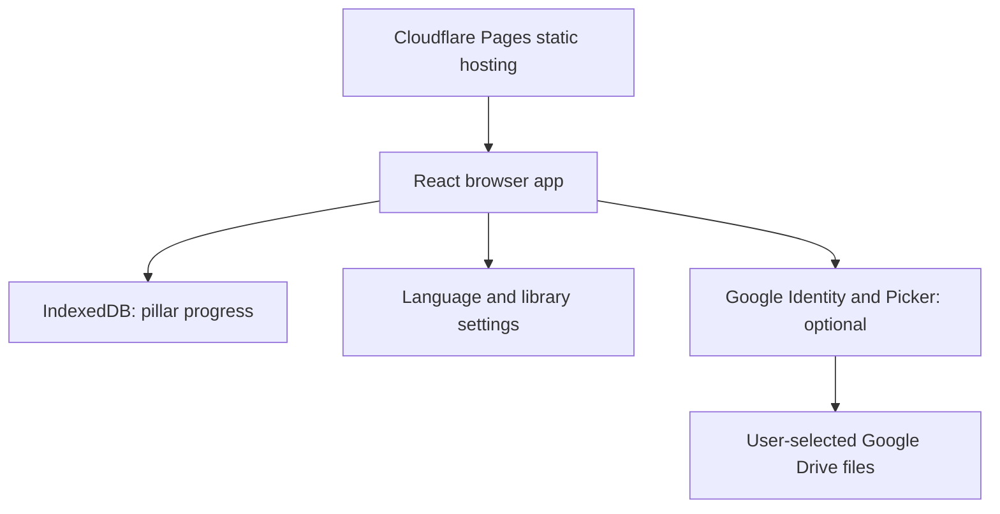

# Pilares - Small steps, in the direction that matters

[Português (Brasil)](README.pt-BR.md) | **English**

## Demo

[](https://pilares.pages.dev/)

Open in your browser. No installation or terminal required.


A local-first web app for five dimensions of life: Spiritual, Mental and Emotional, Physical, Intellectual, and Financial.

Private source repository · Documentation checked on **2026-10-01**.


> The five pillar spaces and the PT/EN interface are implemented. Quality improvements remain open. This is not a claim of production readiness, full WCAG compliance, or completion of the audit roadmap. Core tracking needs no account; the optional cloud library uses Google sign-in.

## Contents

- [Why this exists](#why-this-exists)
- [Planning](#planning)
- [Features](#features)
- [Architecture](#architecture)
- [Design and snapshots](#design-and-snapshots)
- [Development process](#development-process)
- [Performance](#performance)
- [Security and privacy](#security-and-privacy)
- [Testing](#testing)
- [Local development and deployment](#local-development-and-deployment)
- [Roadmap](#roadmap)
- [Credits and license](#credits-and-license)

## Why this exists

Daily care is spread across habits, notes and separate tools. Pilares brings five life dimensions into one calm place, so a small daily step is easier to record and revisit. The product is built around progress rather than competition. Faith-specific controls are optional; financial goals are defined by each user, not prescribed by the app.

## Planning

### Goals

- Make daily check-ins short and understandable.
- Keep core tracking usable without an account and offline after the first visit.
- Store progress locally rather than sending it to a custom backend.
- Keep the interface usable on a phone and desktop, in Portuguese and English.

### User stories

| Need | Product response |
| --- | --- |
| I want to record a small daily habit quickly. | Daily controls and home summaries for each pillar. |
| I want to revisit earlier days without losing them. | Date-based records and weekly/monthly history. |
| I want to try the app before logging in. | No account required for core tracking. |
| I want to read files from my own library. | Optional selection of PDFs from Google Drive (picked in the Google Picker), separate from habit data. |

### Non-goals

No banking integration, investment advice, social feed, custom account system or automatic cross-device sync of pillar progress. Future reading tracks are labelled as future work rather than working features.

## Features

| Pillar | Implemented experience |
| --- | --- |
| Spiritual | 365-day Bible plan, 66 books / 1,189 chapters, reading completion, weekly practice checklist. References only, not a republished Bible translation. |
| Mental and Emotional | Five-level mood check-in, optional notes, monthly calendar, relationships checklist, screen-time tracking, ideas and optional session notes. |
| Physical | Water, sleep, exercise and healthy-eating tracking with daily summaries. |
| Intellectual | Reading-minute goal, learning notebook, skills checklist, interests, Sophia link and optional personal cloud library. |
| Financial | Optional tithing, monthly money-order checklist, monthly reflection, user-defined investment goals and a link to Investor OS. No data sync with Investor OS. |

Additional capabilities: installable PWA, lazy-loaded routes, PT/EN language settings, privacy page and Google disconnect control.

## Architecture



| Layer | Implementation | Reason |
| --- | --- | --- |
| UI | React, TypeScript, Vite, Tailwind CSS 4 | Component-based UI and typed state. |
| Navigation | React.lazy and Suspense per pillar | Load each pillar on demand. |
| Progress | Versioned state through an asynchronous KeyValueStore over IndexedDB | Local persistence and offline use. |
| Dates | Local YYYY-MM-DD records, Monday-based weeks | Avoid UTC date shifts in daily tracking. |
| Offline shell | vite-plugin-pwa | Manifest and service-worker asset cache. |
| Language | PT-BR message keys, English dictionary, Intl dates | One interface with language-specific rendering. |
| Library | Browser OAuth / Google Picker; selection in localStorage, token in sessionStorage | Optional access without a custom backend. |
| Hosting | Cloudflare Pages, main branch, dist output | Static deployment. |

The Bible plan uses bounds based on `floor(day * 1189 / 365)` to distribute every chapter exactly once. Core progress is not synchronized: clearing site data or changing devices can lose it.

## Design and snapshots

Private snapshot links have been removed. No screenshot image was found in the inspected `docs/assets/` directory on 2026-10-07. New privacy-safe captures and upload remain pending.

Dated, repository-owned screenshots remain to be supplied. Private Drive evidence is intentionally not linked.

The current home uses five pillar forms, a muted green palette, serif display headings, numbered spaces and a single invitation to start. This is a description of the shipped design, not a reconstructed early wireframe.


The image is a current public-interface snapshot with no personal records shown. Earlier sketches and intermediate screenshots are not available in this documentation yet; they must not be invented. Future design changes should add dated before/after snapshots and the reason for the change.

## Development process

1. **Define the five spaces:** a shared shell, home summaries and independent pillar routes.
2. **Build core tracking:** deliver the Spiritual, Mental and Emotional, Physical, Intellectual and Financial spaces in phases 1-5.
3. **Review quality:** the 2026-09-28 audit examined security, architecture, performance, privacy and accessibility. It recorded 8 high, 16 medium and 12 low findings at that time, not a current unresolved-issue count.
4. **Reduce exposure:** the private owner's library listing was removed from the public interface/bundle. Private library source must not be re-imported into the public app.
5. **Add optional cloud access and languages:** phase 6.1 introduced visitor-selected Drive files and PT/EN settings.
6. **Document evidence:** this bilingual README, dated snapshot and MIT license were added on 2026-10-01.

Use Git history for exact implementation changes. Phase labels describe sequence; no unsupported per-phase dates or owner-approval claims are used here.

## Performance

The **2026-09-28 laboratory audit** used a local mirror, 4x CPU slowdown, 400 kb/s network, 400 ms latency and one year of synthetic IndexedDB data. It reported cold-start LCP around **7.5 s**, against a **2.5 s target**, and a base bundle around **285 KB raw**.

These are historical lab results, not fresh measurements or real-user metrics. This documentation update did not rerun that benchmark. After performance changes, record the commit, browser/device, dataset, network settings, LCP and bundle size before claiming improvement.

## Security and privacy

- Core pillar progress is stored in the browser's IndexedDB. It is not a secure encrypted vault; shared browser profiles need care.
- The app has no custom backend for pillar progress. Hosting and optional Google services are still third parties; do not describe it as having no network activity.
- Google access is optional. The documented OAuth scope is `drive.file`; it limits accessible files, but the scope itself must not be called read-only. Intended library behavior is reading selected files.
- Library limit (verified in production, 2026-10-08): with `drive.file`, picking a folder in the Google Picker grants only the folder itself, not its contents. The app therefore has no "connect folder" option; the user picks PDFs in the Picker (multi-select, repeatable per folder) and the app keeps that list. A broader scope such as `drive.readonly` would contradict the privacy page and needs an explicit decision.
- OAuth tokens use tab session storage, not repository secrets. A client ID or restricted browser API key does not replace origin restrictions and least-privilege checks.
- The public owner-library list is not part of the intended shipped bundle. Never add personal financial values, book IDs or private links to examples or screenshots.
- `public/_headers` defines the deployed security policy; optional Google login, Picker and the reader need explicit allowed origins.
- Privacy information is available in the app. Export, deletion rights, write integrity and external-tester readiness remain items to validate, not guarantees.

## Testing

Existing documentation records manual checks by phase and a 2026-09-28 accessibility review with axe-core 4.10.2, keyboard navigation and 200% zoom. The audit also found contrast and small-text problems. Do not equate an audit with a passing compliance certificate.

Current `main` exposes `dev`, `build`, `lint`, `preview`, `test`, `test:e2e` and `typecheck`. Vitest and Playwright/axe suites and a GitHub Actions workflow are present. The workflow runs `npm ci`, build, lint, unit tests and end-to-end tests on Node 22. This documentation review inspected source, not every live feature or OAuth flow.

Before a wider beta, record reproducible checks for:

- persistence after reload and failed IndexedDB writes;
- dates, week/month boundaries, leap years and daylight-saving transitions;
- offline start and route navigation;
- keyboard, contrast, touch targets and PT/EN rendering;
- Drive selection/disconnect and accidental private-data publication;
- export, delete-all and recovery behavior of the existing controls.

## Local development and deployment

Use a Node.js version supported by the installed Vite release. The existing setup documents Node.js 20.19+ or 22.12+.

```sh
npm ci
npm run dev
npm run lint
npm run build
npm run preview
```

A lockfile is now versioned. Use `npm ci` for a reproducible install, then `npm run typecheck`, `npm run lint`, `npm test` and `npm run test:e2e`. Never add personal data or secrets to the repository.

Cloudflare Pages builds the private main branch with `npm install && npm run build` and publishes `dist`. The public website and private source are different audiences. Adding MIT does not make the repository public.

## Roadmap

- [ ] Re-test and close write-integrity, privacy and accessibility findings.
- [ ] Extend the existing automated interaction/privacy suites and repeat live checks.
- [ ] Verify the existing Settings export/delete controls end to end; automatic backup remains absent.
- [ ] Re-measure cold-start performance after changes.
- [ ] Add documented alternative Bible reading tracks.
- [ ] Preserve dated design decisions and before/after images as work happens.

## Credits and license

Built with React, TypeScript, Vite, Tailwind CSS and vite-plugin-pwa. Bible chapter counts were cross-checked against [VerseNotes](https://versenotes.org/a-list-of-books-in-the-bible-by-number-of-chapters/) and [Living Greek NT](https://www.livinggreeknt.org/resources/chapter-count.php). The uniform reading distribution is original, not copied from an editorial reading plan.

[MIT license](LICENSE), copyright 2026 Iuri Johansson. Third-party libraries, services and content retain their own terms.

## Documentation review - 2026-10-07

This is a documentation draft, not a release or a fresh runtime audit. Current repository visibility, README files, package scripts and root license paths were checked. Historical runtime and benchmark results above have not been rerun. Screenshots require a separate capture, privacy check, upload and rendered-image check before completion. Missing images are not replaced with broken embeds.

Source inspection of `src/pages/Configuracoes.tsx` confirms export and delete-all controls exist. Their complete behavior, failure recovery and live deployment were not tested in this review.

## Current source reconciliation - 2026-10-08

Compared with `main` after audit PR #10: local font packages replace Google Fonts; TypeScript strict mode, a lockfile, unit/e2e scripts and CI are present. The PDF reader uses a native dialog plus iframe sandbox and no-referrer policy. The `drive.file` scope is limited to authorized files but is not read-only. These source facts are not fresh runtime passes. A real Drive PDF still needs owner testing; sandbox behavior and Google API-key restrictions remain separate checks.

Subfolder navigation is proposed in open [PR #16](https://github.com/iurjoh/pilares/pull/16), not delivered in the main inspected here. Current code lists PDFs in the selected folder, without the proposed subfolder breadcrumb. Documentation of that feature belongs to its eventual reviewed merge.
