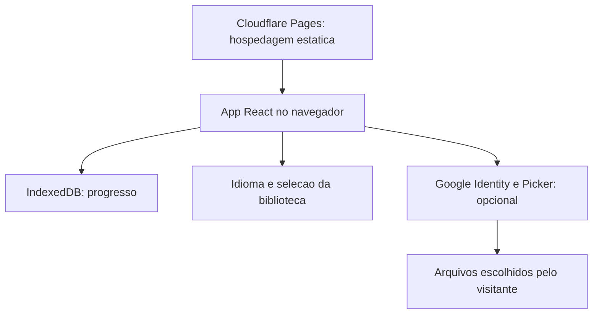

# Pilares - Pequenos passos, na direção do que importa

**Português (Brasil)** | [English](README.md)


Aplicativo local-first para cinco dimensões da vida: Espiritual, Mental e Emocional, Físico, Intelectual e Financeiro.

**[Experimente](https://pilares.pages.dev/)** · Repositório privado · Documentação conferida em **01/10/2026**.


> Os cinco espaços e a interface PT/EN estão implementados. Melhorias de qualidade continuam abertas. Isso não significa prontidão para produção, conformidade WCAG completa ou conclusão da auditoria. O acompanhamento básico não exige conta; a biblioteca opcional usa login Google.

## Por que existe

O cuidado diário costuma ficar espalhado entre hábitos, anotações e ferramentas. O Pilares reúne cinco dimensões em um lugar calmo, para facilitar o registro e a revisão de pequenos passos. O foco é progresso, não competição. Controles religiosos são opcionais e cada pessoa define suas metas financeiras.

## Planejamento

**Objetivos:** registros rápidos; uso básico sem conta e offline após a primeira visita; progresso local, sem backend próprio; interface para celular e desktop em português e inglês.

| Necessidade | Resposta do produto |
| --- | --- |
| Registrar um hábito rapidamente | Controles diários e resumos por pilar. |
| Rever dias anteriores | Registros por data e histórico semanal/mensal. |
| Experimentar sem login | Acompanhamento básico sem conta. |
| Ler minha biblioteca | Seleção opcional de arquivos do Google Drive, separada dos hábitos. |

**Fora do escopo:** integração bancária, recomendação de investimentos, rede social, contas próprias e sincronização automática do progresso entre aparelhos. Trilhas futuras não são apresentadas como prontas.

## Funcionalidades

| Pilar | Experiência implementada |
| --- | --- |
| Espiritual | Plano de 365 dias, 66 livros e 1.189 capítulos; marcação de leituras e checklist semanal. Referências, sem republicar traduções bíblicas. |
| Mental e Emocional | Humor em cinco níveis, notas opcionais, calendário, checklist de relações, tempo de telas, ideias e notas opcionais de sessões. |
| Físico | Água, sono, exercício e alimentação com resumos diários. |
| Intelectual | Meta de minutos de leitura, aprendizado, habilidades, interesses, link do Sophia e biblioteca pessoal opcional. |
| Financeiro | Dízimo opcional, ordem mensal do dinheiro, reflexão e metas próprias; link do Investor OS sem sincronizar dados. |

PWA instalável, rotas sob demanda, idiomas PT/EN, política de privacidade e desconexão Google.

## Arquitetura



| Camada | Escolha e motivo |
| --- | --- |
| Interface | React, TypeScript, Vite e Tailwind CSS 4: componentes e estado tipado. |
| Navegação | React.lazy e Suspense: carregamento por pilar. |
| Progresso | Estado versionado sobre KeyValueStore assíncrono e IndexedDB: persistência local. |
| Datas | AAAA-MM-DD local e semanas iniciadas segunda-feira: evitar mudança de dia por UTC. |
| Offline | vite-plugin-pwa: manifesto e cache de assets. |
| Idiomas | Chaves PT-BR, dicionário inglês e Intl para datas. |
| Biblioteca | OAuth/Picker no navegador; seleção em localStorage e token em sessionStorage. |
| Publicação | Cloudflare Pages, branch main e saída dist. |

O plano bíblico usa limites `floor(dia * 1189 / 365)` para distribuir cada capítulo uma vez. O progresso não é sincronizado: limpar dados do site ou mudar de aparelho pode perdê-lo.

## Design e snapshots

A home atual usa cinco formas de pilares, verdes suaves, títulos serifados, espaços numerados e um convite único para começar. É o design publicado, não uma reconstrução de wireframes antigos.

| Snapshot | Data | Evidência |
| --- | --- | --- |
| [Home desktop](snapshot-2026-10-01-home-desktop.png) | 01/10/2026 | Hero e navegação atuais, interface em inglês, sem registros pessoais na imagem. |

Esboços e capturas intermediárias ainda não estão reunidos aqui. Não inventar esses registros. Cada mudança futura deve guardar capturas antes/depois, data e motivo.

## Processo de desenvolvimento

1. Definir cinco espaços, estrutura comum, resumos e rotas independentes.
2. Implementar os módulos nas fases 1-5.
3. Auditar qualidade em 28/09/2026: segurança, arquitetura, desempenho, privacidade e acessibilidade. Foram registrados 8 achados altos, 16 médios e 12 baixos naquele momento; isso não é a contagem atual de pendências.
4. Retirar a listagem privada do dono da interface/bundle público. Não reimportar a fonte privada no app.
5. Acrescentar biblioteca escolhida pelo visitante e idiomas na fase 6.1.
6. Acrescentar documentação bilíngue, snapshot datado e MIT em 01/10/2026.

O histórico Git registra mudanças exatas. Fases indicam sequência; não foram inventadas datas por fase nem declarações de aprovação do dono.

## Desempenho

Auditoria de laboratório de **28/09/2026**: espelho local, CPU 4x mais lenta, 400 kb/s, latência de 400 ms e um ano de dados sintéticos. LCP de abertura fria em torno de **7,5 s**, meta de **2,5 s**, bundle base de aproximadamente **285 KB brutos**.

São resultados históricos de laboratório, não métricas atuais ou de usuários reais. Esta atualização não repetiu o benchmark. Ao medir novamente, registrar commit, aparelho/navegador, dados, rede, LCP e bundle antes de afirmar melhora.

## Segurança e privacidade

- Progresso no IndexedDB; não é cofre criptografado. Cuidado com perfis de navegador compartilhados.
- Sem backend próprio de hábitos, mas hospedagem e Google opcional são terceiros. Não prometer ausência de atividade de rede.
- O escopo OAuth documentado é `drive.file`: limita arquivos acessíveis, mas não é um escopo somente leitura. A finalidade da biblioteca é ler arquivos selecionados.
- Token na sessão da aba. Client ID e API key restrita não substituem restrições de origem e privilégio mínimo.
- A listagem da biblioteca do dono não deve integrar o bundle público. Não colocar valores financeiros pessoais, IDs de livros ou links privados em exemplos e capturas.
- `public/_headers` define a política de segurança; Google login, Picker e leitor exigem origens explícitas.
- Política de privacidade no app. Exportação, exclusão, integridade da gravação e preparação para testers precisam de validação, não de garantias antecipadas.

## Testes

A documentação anterior registra verificações manuais por fase e auditoria em 28/09/2026 com axe-core 4.10.2, teclado e zoom 200%. Houve problemas de contraste e textos pequenos; auditoria não equivale a certificado de conformidade.

O `package.json` oferece `dev`, `build`, `lint` e `preview`, mas nenhum script automatizado `test`. Esta atualização conferiu a home pública e a documentação, não todos os recursos ou o fluxo OAuth.

Antes de ampliar o beta, registrar testes reproduzíveis de persistência/reload/falhas de gravação; datas, semanas, meses, anos bissextos e horário de verão; offline; teclado, contraste, toque e idiomas; seleção/desconexão Drive e publicação acidental; exportação, apagar tudo e recuperação quando implementados.

## Execução local e publicação

Usar Node.js compatível com a versão instalada do Vite. A configuração existente documenta Node.js 20.19+ ou 22.12+.

```sh
npm install
npm run dev
npm run lint
npm run build
npm run preview
```

Sem lockfile versionado: usar `npm install`, não `npm ci`. Não adicionar dados pessoais nem segredos.

Cloudflare Pages publica `dist` após `npm install && npm run build` no main privado. Site público e código privado têm públicos diferentes. MIT não torna o repositório público.

## Próximos passos

- [ ] Retestar integridade da gravação, privacidade e acessibilidade.
- [ ] Automatizar testes de interação e privacidade.
- [ ] Exportação/backup de progresso e verificação da exclusão.
- [ ] Repetir medição de abertura fria após alterações.
- [ ] Trilhas bíblicas alternativas documentadas.
- [ ] Guardar decisões e snapshots antes/depois durante o trabalho.

## Créditos e licença

React, TypeScript, Vite, Tailwind CSS e vite-plugin-pwa. Capítulos conferidos com [VerseNotes](https://versenotes.org/a-list-of-books-in-the-bible-by-number-of-chapters/) e [Living Greek NT](https://www.livinggreeknt.org/resources/chapter-count.php). Distribuição uniforme autoral, sem copiar plano editorial.

[MIT](LICENSE), copyright 2026 Iuri Johansson. Bibliotecas, serviços e conteúdo de terceiros mantêm seus próprios termos.
