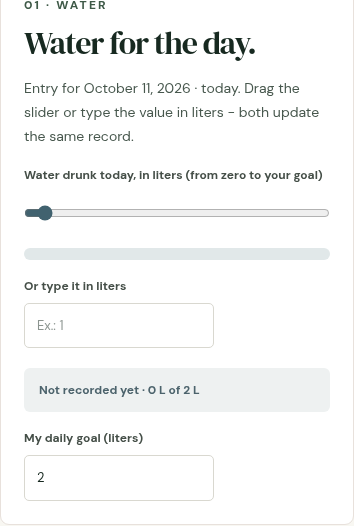

# Pilares

**Português (Brasil)** | [English](README.md)

Acompanhe pequenos hábitos e reflexões em cinco áreas da vida. Registre um passo de hoje e reveja seu progresso em um só lugar, sem conta para o uso básico.

## Demo

[Abrir o app](https://pilares.pages.dev/)

Abra no navegador, sem instalar nada ou usar o terminal.



Interface da imagem em inglês, capturada em 11/10/2026 sem registros pessoais. O app pode mostrar os rótulos em inglês ou português, conforme o idioma escolhido.

## Experimente um pequeno passo

1. Abra a demo e escolha **Físico**. No celular, use a navegação dos pilares ou os cartões da home.
2. Em **Água do dia.**, no campo **Ou escreva em litros**, digite `0.5` (meio litro). Não altere **Minha meta diária (litros)**. O resumo deve mostrar a quantidade registrada.
3. Abra **Configurações** para alternar entre português e inglês. Use registros fictícios ao explorar; seu progresso pertence a este navegador.

Esse primeiro uso não exige login Google. A biblioteca pessoal opcional usa login Google e arquivos escolhidos do Drive.

## O que você pode usar

| Espaço | Exemplos |
| --- | --- |
| Espiritual | Referências a capítulos bíblicos, leituras concluídas e práticas semanais. |
| Mental e Emocional | Registro de humor, notas opcionais e calendário. |
| Físico | Água, sono, movimento e alimentação. |
| Intelectual | Minutos de leitura, notas de aprendizado e biblioteca opcional na nuvem. |
| Financeiro | Checklists mensais e metas que você define. Sem conexão bancária ou recomendação de investimentos. |

Português e inglês usam a mesma interface. O progresso básico fica local e não é sincronizado automaticamente entre aparelhos.

## Status e limites

Beta em evolução. Os cinco espaços existem, mas recursos implementados e build verde não são um certificado completo de acessibilidade nem garantia de recuperação dos dados.

- Limpar os dados do site ou mudar de aparelho pode perder o progresso. Não há backup automático.
- Configurações tem controles de exportação e exclusão total. Arquivos exportados podem conter notas sensíveis; guarde-os em lugar privado.
- O acesso Google é opcional. O escopo `drive.file` limita arquivos acessíveis, mas não é somente leitura. A pessoa seleciona PDFs; escolher uma pasta não libera seu conteúdo.
- O app não é um cofre criptografado. Cuidado com perfis de navegador compartilhados.

## Testes

O trabalho de QA desenvolvido em `feat/qa-local` acrescenta:

```sh
npm run qa
```

Esse comando reúne Vitest e Playwright. A nova spec verifica navegação entre os cinco pilares e registro de humor, nota, prática e tempo de telas com recarga, usando dados fictícios; também verifica acessibilidade após a interação. Os testes do candidato não certificam todos os recursos nem o OAuth real. No início desta revisão (11/10/2026), main em be097e4 ainda não incluía este comando.

## Histórico do projeto

O projeto começou com cinco espaços independentes em uma estrutura comum, depois ganhou progresso local, idiomas e acesso à biblioteca escolhida pelo visitante. O trabalho de privacidade retirou a listagem privada da biblioteca do dono da interface pública.

Uma auditoria de 28/09/2026 registrou achados de acessibilidade, segurança e desempenho. Os resultados históricos ficam no registro de construção; não são a contagem de pendências de hoje.

[História da construção, arquitetura, decisões de design e auditorias históricas](docs/BUILD.pt-BR.md)

## Créditos e licença

Iuri Johansson define a direção e as decisões do projeto; Instinct auxilia na implementação e documentação.

[Licença MIT](LICENSE), copyright 2026 Iuri Johansson. Bibliotecas, serviços e outros conteúdos mantêm seus próprios termos. O plano bíblico usa referências a capítulos, sem republicar uma tradução; as fontes originais das contagens permanecem no registro de construção.

## Retrato da tecnologia e do esforço

Registro das fontes do repositório em 2026-10-14. É um retrato do código, não uma afirmação sobre versões em produção nem sobre a tecnologia disponível no lançamento original.

- **Stack neste registro:** React 19.3.0; TypeScript 7.0.2; Vite 8.3.3; Tailwind CSS 4.3.3 (package-lock.json).
- **Registro anterior:** O primeiro package.json preservado (1505e4b) declara React ^19.2.8, TypeScript ~6.0.2 e Vite ^8.3.0. São faixas declaradas, não versões resolvidas de uma instalação.
- **Janela de calendário observada:** 2026-09-28 a 2026-10-11: commits preservados e alcançáveis em main. Intervalo de calendário, não trabalho contínuo nem prazo até o lançamento.
- **Pull requests:** 22 PRs visíveis: 1 aberto, 21 fechados, consultados em 2026-10-14 antes desta alteração. Fechado não significa mergeado. Histórico apagado/recriado não entra na contagem.
- **Decisão e motivo:** O IndexedDB local permite registrar hábitos sem conta; a seleção opcional de arquivos evita publicar uma biblioteca privada.
- **Estimativa de esforço ativo:** indisponível. Não foi estabelecido um registro confiável de tempo nem uma reconstrução delimitada das sessões de trabalho. Contagem de commits e tempo de calendário não são convertidos em horas.

Evidências: arquivos de dependências/código citados acima, histórico Git preservado e lista de PRs do repositório. Versões e contagens pertencem a este registro, não são contadores ao vivo.
