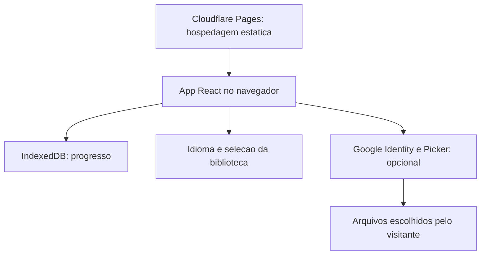

# Registro de construção e auditorias

Este documento preserva o registro de documentação anterior ao piloto de 11/10/2026. Datas e resultados abaixo são históricos, não uma certificação atual. Referências a PRs abertos e capturas pendentes refletem a revisão da época. Consulte o README principal para o estado do candidato em revisão.

## Por que existe

O cuidado diário costuma ficar espalhado entre hábitos, anotações e ferramentas. O Pilares reúne cinco dimensões em um lugar calmo, para facilitar o registro e a revisão de pequenos passos. O foco é progresso, não competição. Controles religiosos são opcionais e cada pessoa define suas metas financeiras.

## Planejamento

**Objetivos:** registros rápidos; uso básico sem conta; projetado para uso offline após a primeira visita, ainda em validação; progresso local, sem backend próprio; interface para celular e desktop em português e inglês.

| Necessidade | Resposta do produto |
| --- | --- |
| Registrar um hábito rapidamente | Controles diários e resumos por pilar. |
| Rever dias anteriores | Registros por data e histórico semanal/mensal. |
| Experimentar sem login | Acompanhamento básico sem conta. |
| Ler minha biblioteca | Seleção opcional de PDFs do Google Drive (escolhidos no Google Picker), separada dos hábitos. |

**Fora do escopo:** integração bancária, recomendação de investimentos, rede social, contas próprias e sincronização automática do progresso entre aparelhos. Trilhas futuras não são apresentadas como prontas.

## Funcionalidades

| Pilar | Experiência implementada |
| --- | --- |
| Espiritual | Plano de 365 dias, 66 livros e 1.189 capítulos; marcação de leituras e checklist semanal. Referências, sem republicar traduções bíblicas. |
| Mental e Emocional | Humor em cinco níveis, notas opcionais, calendário, checklist de relações, tempo de telas, ideias e notas opcionais de sessões. |
| Físico | Água, sono, exercício e alimentação com resumos diários. |
| Intelectual | Meta de minutos de leitura, aprendizado, habilidades, interesses, link do Sophia e biblioteca pessoal opcional. |
| Financeiro | Dízimo opcional, ordem mensal do dinheiro, reflexão e metas próprias; link do Investor OS sem sincronizar dados. |

PWA instalável, rotas sob demanda, idiomas PT/EN, política de privacidade e desconexão Google.

## Arquitetura



| Camada | Escolha e motivo |
| --- | --- |
| Interface | React, TypeScript, Vite e Tailwind CSS 4: componentes e estado tipado. |
| Navegação | React.lazy e Suspense: carregamento por pilar. |
| Progresso | Estado versionado sobre KeyValueStore assíncrono e IndexedDB: persistência local. |
| Datas | AAAA-MM-DD local e semanas iniciadas segunda-feira: evitar mudança de dia por UTC. |
| Offline | vite-plugin-pwa: manifesto e cache de assets. |
| Idiomas | Chaves PT-BR, dicionário inglês e Intl para datas. |
| Biblioteca | OAuth/Picker no navegador; seleção em localStorage e token em sessionStorage. |
| Publicação | Cloudflare Pages, branch main e saída dist. |

O plano bíblico usa limites `floor(dia * 1189 / 365)` para distribuir cada capítulo uma vez. O progresso não é sincronizado: limpar dados do site ou mudar de aparelho pode perdê-lo.

## Design e snapshots

Links privados de capturas removidos. Nenhuma imagem foi encontrada na pasta `docs/assets/` inspecionada em 07/10/2026. Novas capturas sem dados pessoais e upload seguem pendentes.

Capturas datadas no próprio repositório seguem pendentes. Evidência privada do Drive não é linkada.

A home atual usa cinco formas de pilares, verdes suaves, títulos serifados, espaços numerados e um convite único para começar. É o design publicado, não uma reconstrução de wireframes antigos.


Esboços e capturas intermediárias ainda não estão reunidos aqui. Não inventar esses registros. Cada mudança futura deve guardar capturas antes/depois, data e motivo.

## Processo de desenvolvimento

1. Definir cinco espaços, estrutura comum, resumos e rotas independentes.
2. Implementar os módulos nas fases 1-5.
3. Auditar qualidade em 28/09/2026: segurança, arquitetura, desempenho, privacidade e acessibilidade. Foram registrados 8 achados altos, 16 médios e 12 baixos naquele momento; isso não é a contagem atual de pendências.
4. Retirar a listagem privada do dono da interface/bundle público. Não reimportar a fonte privada no app.
5. Acrescentar biblioteca escolhida pelo visitante e idiomas na fase 6.1.
6. Acrescentar documentação bilíngue, snapshot datado e MIT em 01/10/2026.

O histórico Git registra mudanças exatas. Fases indicam sequência; não foram inventadas datas por fase nem declarações de aprovação do dono.

## Desempenho

Auditoria de laboratório de **28/09/2026**: espelho local, CPU 4x mais lenta, 400 kb/s, latência de 400 ms e um ano de dados sintéticos. LCP de abertura fria em torno de **7,5 s**, meta de **2,5 s**, bundle base de aproximadamente **285 KB brutos**.

São resultados históricos de laboratório, não métricas atuais ou de usuários reais. Esta atualização não repetiu o benchmark. Ao medir novamente, registrar commit, aparelho/navegador, dados, rede, LCP e bundle antes de afirmar melhora.

## Segurança e privacidade

- Progresso no IndexedDB; não é cofre criptografado. Cuidado com perfis de navegador compartilhados.
- Sem backend próprio de hábitos, mas hospedagem e Google opcional são terceiros. Não prometer ausência de atividade de rede.
- O escopo OAuth documentado é `drive.file`: limita arquivos acessíveis, mas não é um escopo somente leitura. A finalidade da biblioteca é ler arquivos selecionados.
- Limite da biblioteca (verificado em produção em 08/10/2026): com `drive.file`, escolher uma pasta no Google Picker libera só a pasta, não o conteúdo. Por isso o app não tem "conectar pasta": a pessoa escolhe PDFs no Picker (multisseleção, repetível por pasta) e o app guarda a lista. Um escopo mais amplo como `drive.readonly` contradiria a página de privacidade e exige decisão explícita.
- Token na sessão da aba. Client ID e API key restrita não substituem restrições de origem e privilégio mínimo.
- A listagem da biblioteca do dono não deve integrar o bundle público. Não colocar valores financeiros pessoais, IDs de livros ou links privados em exemplos e capturas.
- `public/_headers` define a política de segurança; Google login, Picker e leitor exigem origens explícitas.
- Política de privacidade no app. Exportação, exclusão, integridade da gravação e preparação para testers precisam de validação, não de garantias antecipadas.

## Testes

A documentação anterior registra verificações manuais por fase e auditoria em 28/09/2026 com axe-core 4.10.2, teclado e zoom 200%. Houve problemas de contraste e textos pequenos; auditoria não equivale a certificado de conformidade.

O main atual oferece `dev`, `build`, `lint`, `preview`, `test`, `test:e2e` e `typecheck`. Há suites Vitest e Playwright/axe e workflow GitHub Actions com Node 22, `npm ci`, build, lint, unit e e2e. Esta revisão inspecionou código, não todos os recursos ao vivo nem OAuth.

Antes de ampliar o beta, registrar testes reproduzíveis de persistência/reload/falhas de gravação; datas, semanas, meses, anos bissextos e horário de verão; offline; teclado, contraste, toque e idiomas; seleção/desconexão Drive e publicação acidental; exportação, apagar tudo e recuperação dos controles existentes.

## Execução local e publicação

Usar Node.js compatível com a versão instalada do Vite. A configuração existente documenta Node.js 20.19+ ou 22.12+.

```sh
npm ci
npm run dev
npm run lint
npm run build
npm run preview
```

Lockfile versionado: usar `npm ci`, depois `npm run typecheck`, `npm run lint`, `npm test` e `npm run test:e2e`. Não adicionar dados pessoais nem segredos.

Cloudflare Pages publica `dist` após `npm install && npm run build` no main privado. Site público e código privado têm públicos diferentes. MIT não torna o repositório público.

## Próximos passos

- [ ] Retestar integridade da gravação, privacidade e acessibilidade.
- [ ] Ampliar as suites automatizadas existentes de interação/privacidade e repetir checks ao vivo.
- [ ] Verificar os controles existentes de exportação/exclusão em Configurações; não há backup automático.
- [ ] Repetir medição de abertura fria após alterações.
- [ ] Trilhas bíblicas alternativas documentadas.
- [ ] Guardar decisões e snapshots antes/depois durante o trabalho.

## Créditos e licença

React, TypeScript, Vite, Tailwind CSS e vite-plugin-pwa. Capítulos conferidos com [VerseNotes](https://versenotes.org/a-list-of-books-in-the-bible-by-number-of-chapters/) e [Living Greek NT](https://www.livinggreeknt.org/resources/chapter-count.php). Distribuição uniforme autoral, sem copiar plano editorial.

[MIT](../LICENSE), copyright 2026 Iuri Johansson. Bibliotecas, serviços e conteúdo de terceiros mantêm seus próprios termos.

## Revisão documental - 07/10/2026

Este é um draft de documentação, não uma release nem nova auditoria de runtime. Foram conferidos visibilidade atual do repo, READMEs, scripts e caminho da licença na raiz. Testes e benchmarks históricos acima não foram repetidos. Capturas precisam de criação, revisão de privacidade, upload e inspeção da imagem renderizada. Imagens ausentes não são substituídas por embeds quebrados.

O código de `src/pages/Configuracoes.tsx` confirma controles de exportação e exclusão total. Fluxo completo, recuperação de falhas e deploy não foram testados nesta revisão.

## Reconciliação com o código atual - 08/10/2026

Comparado com `main` após PR de auditoria #10: pacotes locais de fontes substituem Google Fonts; TypeScript strict, lockfile, scripts unit/e2e e CI existem. O leitor PDF usa dialog nativo e iframe com sandbox e política no-referrer. O escopo `drive.file` limita arquivos autorizados, mas não é somente leitura. Isso comprova código presente, não novos testes de runtime. Um PDF real do Drive ainda precisa de teste do dono; sandbox e restrições da chave Google são verificações separadas.

Navegação por subpastas é proposta no PR #16 (aberto na revisão de 08/10/2026; fechado depois), não funcionalidade entregue no main inspecionado. O código atual lista PDFs da pasta escolhida, sem o breadcrumb proposto. A documentação definitiva acompanha o eventual merge revisado desse PR.


## Candidato de QA - 11/10/2026

Base informada: `be097e40bb506b61ca765193e4705113790a158b`. Handoff2 SHA-256: `abc395ca21d059b7dc78578c9e1011d97874cf3bf10f25ff6fe5c53282278a32`. Head remoto ainda pendente. O candidato acrescenta `npm run qa` (`vitest run && playwright test`), uma spec de fluxos e o ajuste de contraste do humor selecionado. Esse registro comprova os arquivos recebidos, não uma execução concluída. A suíte bloqueia chamadas Google nesses fluxos; isso não prova ausência de toda requisição externa.

A home de 11/10/2026 e a captura funcional de Água ficam em `docs/assets/`; capturas anteriores continuam ausentes.

## Para desenvolvedores

React, TypeScript, Vite e Tailwind CSS. O progresso básico usa IndexedDB; Cloudflare Pages serve o app estático. Os serviços Google opcionais são separados do acompanhamento básico.

```sh
npm ci
npm run dev
```

Use Node.js compatível com a versão instalada do Vite (a configuração existente documenta 20.19+ ou 22.12+). O código atual inclui estes scripts:

```sh
npm run typecheck
npm run lint
npm test
npm run test:e2e
npm run build
```

São comandos para executar, não uma afirmação de que esta mudança de documentação rodou todos os testes. A branch de QA de interações é revisada separadamente e precisa ser conciliada antes da publicação deste piloto.

## Próximas verificações

- Validar falhas de gravação, limites de datas, uso offline e recuperação.
- Verificar PDFs reais do Drive, desconexão e restrições de acesso.
- Testar exportação e exclusão total de ponta a ponta.
- Medir desempenho novamente após mudanças, com commit e condições de teste.
- Guardar capturas datadas e evidências antes/depois conforme o produto muda.
